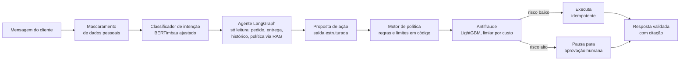

# Deliverius AI

[](https://github.com/lucasg0m7s/deliverius-ai/actions/workflows/ci.yml)


[](LICENSE)

**Deli** é o agente de atendimento com IA do Deliverius, um app de delivery fictício. Quando um cliente escreve
"meu pedido chegou sem o refrigerante", o Deli entende o problema, consulta o pedido, aplica a política da empresa e
resolve: reembolsa, emite cupom, cancela ou chama um humano para aprovar. Tudo com custo, latência e qualidade
medidos.

> Projeto de portfólio em desenvolvimento. O Deliverius não existe: dados, políticas e clientes são sintéticos.

**A ideia central: o LLM propõe, o código decide.** O modelo entende a conversa e sugere uma ação; quem decide se ela
pode sair é um motor de política determinístico e um antifraude treinado. Nenhum valor de reembolso depende de o LLM
obedecer.



## O que olhar primeiro

| Parte | Por que é interessante | Onde |
| --- | --- | --- |
| **Motor de política** | Regras de reembolso, cupom e cancelamento em código puro, com os números numa fonte única que também preenche os documentos citados pelo RAG: o texto nunca contradiz a regra. 100% dos ramos cobertos | [`src/deliverius/policy/`](src/deliverius/policy/), [`docs/modelo-dominio.md`](docs/modelo-dominio.md#3-a-política-do-deliverius) |
| **Mascaramento (LGPD)** | CPF, CNPJ (inclusive o alfanumérico), cartão, telefone, e-mail, CEP e endereço mascarados antes de qualquer LLM ou log, com recall medido por tipo e limites publicados | [`src/deliverius/privacy/`](src/deliverius/privacy/), [`docs/seguranca.md`](docs/seguranca.md#4-mascaramento-de-dados-pessoais-privacy) |
| **Camada de LLM** | Papéis por tarefa, provedores trocáveis (Gemini, Groq, Ollama), orçamento diário com reserva atômica no Postgres, pausa depois de um `429`, modo degradado tipado e custo por chamada | [`src/deliverius/llm/`](src/deliverius/llm/), [`docs/arquitetura.md`](docs/arquitetura.md#camada-de-llm) |
| **Busca nas políticas (RAG)** | Full-text em português sem acento e embeddings `multilingual-e5-small` em ONNX (sem PyTorch), fundidos por RRF em SQL, com regra de "busca não confiável" para o agente não inventar regra. Porta de qualidade no CI | [`src/deliverius/retrieval/`](src/deliverius/retrieval/), [`docs/busca-politicas.md`](docs/busca-politicas.md) |
| **Dados sintéticos** | O cenário vem primeiro e o rótulo é verdade de construção: o LLM só escreve o texto, com marcadores que o código preenche. Reprodutível por semente e cache, com divisões testadas contra vazamento | [`src/deliverius/datagen/`](src/deliverius/datagen/), [`docs/modelo-dominio.md`](docs/modelo-dominio.md#4-gerador-de-dados-sintéticos-datagen) |
| **Decisões** | Cada decisão de arquitetura com as alternativas consideradas e o porquê | [`docs/decisoes-arquitetura.md`](docs/decisoes-arquitetura.md) |

## Números até aqui

| O quê | Resultado |
| --- | --- |
| Testes | 1.674 unitários (98% de cobertura) e 170 de integração contra Postgres real (Testcontainers) |
| Motor de política e mascaramento | 100% de cobertura de ramos, exigida no CI |
| Recall do mascaramento | Acima de 99% nos tipos estruturados em dados sintéticos; nomes próprios ainda não reconhecidos (limite escrito) |
| Custo de LLM | Chamada real com ferramenta: US$ 0,000079 no Gemini e US$ 0,000048 no Groq (preço de lista equivalente; o projeto roda na cota gratuita), latência de 0,7 s e 0,3 a 0,5 s |
| Dataset sintético | 2.969 mensagens rotuladas em 11 intenções, 550 de teste de outro gerador, 20.000 pedidos com 3.378 reclamações rotuladas para o antifraude (11,8% de fraude), 60 pares pergunta → política, 150 cenários de ponta a ponta |

## Busca nas políticas: por que híbrida?

60 perguntas → seção da política, acerto nos 3 primeiros trechos (intervalo de 95% por bootstrap):

| Modo | recall@3 (seção) | MRR@3 (seção) | recall@3 (documento) |
| --- | --- | --- | --- |
| Lexical (full-text `pt_unaccent`) | 0,35 [0,22; 0,47] | 0,21 | 0,52 |
| Semântica (e5-small, ONNX) | 0,55 [0,43; 0,67] | 0,43 | 0,70 |
| Híbrida (RRF) | 0,55 [0,42; 0,68] | 0,41 | 0,72 |

Latência p95 de 29 ms em CPU. Com 60 pares, a híbrida não se mostrou melhor que a semântica com significância; fica
pelos termos exatos e números que a semântica dilui, e o relatório mostra por que boa parte dos erros por seção é
ambiguidade de rótulo. A regra de busca não confiável recusa 63% das perguntas fora do escopo e mantém 98% das
perguntas da política. Detalhes, achados e limites em [`docs/busca-politicas.md`](docs/busca-politicas.md).

## Status

O plano completo, change por change, está em [`docs/roadmap.md`](docs/roadmap.md). Cada change nasce como proposta no
[OpenSpec](https://github.com/Fission-AI/OpenSpec) (`openspec/changes/`) e é arquivada só com a verificação verde
(`openspec/changes/archive/`).

| # | Change | Entrega | Status |
| --- | --- | --- | --- |
| 1 | `fundacao-projeto` | Python 3.13, uv, FastAPI, Postgres + pgvector, Docker sem root, CI | ✅ |
| 2 | `nucleo-dominio` | Pedidos, linha do tempo, escopo de acesso no `WHERE`, auditoria só de inserção | ✅ |
| 3 | `motor-politica` | Motor de política puro e 12 documentos com números de fonte única | ✅ |
| 4 | `mascaramento-dados` | Detecção e mascaramento de dados pessoais com marcadores estáveis | ✅ |
| 5 | `camada-llm` | Papéis, provedores, orçamento, registro de uso e custo, cache, modelo falso | ✅ |
| 6 | `gerador-dados` | Dados sintéticos rotulados por construção, CLI, publicação no Hugging Face | 🔄 |
| 8 | `busca-politicas` | Busca híbrida nas políticas com avaliação e porta no CI | 🔄 |
| 7, 9, 10 | Modelos | Pesquisa de intenção (4 abordagens), classificador servido, antifraude | ⏳ |
| 11–14 | Agente e API | Ações e aprovações, agente LangGraph, API, observabilidade | ⏳ |
| 15–17 | Avaliação | Evals com clientes simulados e de segurança, juiz calibrado | ⏳ |
| Extras | — | Demo pública, LoRA, servidor MCP, automação n8n | ⏳ |

## Rodando localmente

Pré-requisitos: [uv](https://docs.astral.sh/uv/), que instala o Python 3.13, e Docker.

```bash
cp .env.example .env
uv sync
docker compose up -d                 # Postgres 17 + pgvector na porta 5433
uv run alembic upgrade head
uv run fastapi dev src/deliverius/api/main.py   # http://localhost:8000/docs
```

### Dados sintéticos

As chaves do Gemini e do Groq (cota gratuita) entram no `.env`. A geração completa faz cerca de 345 chamadas ao Gemini
e 55 ao Groq, dentro da cota de um dia; o cache de respostas permite retomar sem pagar de novo, e repetir a geração com
o mesmo cache produz arquivos idênticos byte a byte.

```bash
uv run python -m deliverius.cli datagen world --seed 42      # só o mundo simulado, sem LLM
uv run python -m deliverius.cli datagen scenarios --seed 42  # cenários de ponta a ponta, sem LLM
uv run python -m deliverius.cli datagen all --seed 42        # tudo, em data/generated/v<versão>/, com manifest.json
uv run python -m deliverius.cli datagen validate-human data/human-test/messages.csv
```

O formato do conjunto de teste escrito por pessoas está em [`data/human-test/README.md`](data/human-test/README.md).

## Qualidade

```bash
uv run ruff format --check .
uv run ruff check .
uv run mypy                          # strict em src/
uv run lint-imports                  # fronteiras entre módulos
uv run pytest                        # unitários, cobertura mínima de 85%
uv run pytest -m integration --no-cov   # integração: o Testcontainers sobe um Postgres com pgvector
```

## Como o projeto é desenvolvido

- **Spec-driven development:** proposta, spec, design e tarefas no OpenSpec antes do código; o design de cada change
  responde a um checklist de robustez (corrida, idempotência, timeout, limites, falha no meio, eventos de log) em
  [`docs/robustez.md`](docs/robustez.md).
- **Monólito modular** com fronteiras verificadas pelo import-linter: regras puras (`policy`, `privacy`) não importam
  banco, web, log nem LLM. Detalhes em [`docs/arquitetura.md`](docs/arquitetura.md).
- **Segurança de LLM:** OWASP LLM Top 10 e riscos agênticos mapeados, regras contra prompt injection e checklist de
  revisão em [`docs/seguranca.md`](docs/seguranca.md); autorização com matriz de acesso em
  [`docs/autorizacao.md`](docs/autorizacao.md).
- **Avaliação:** ciclo de vida de ML com critério de escolha fixado antes dos experimentos e evals no estilo τ-bench em
  [`docs/ml-e-avaliacao.md`](docs/ml-e-avaliacao.md).

| Documento | Conteúdo |
| --- | --- |
| [`arquitetura.md`](docs/arquitetura.md) | Estilo, módulos, regras de import, agente, camada de LLM, RAG |
| [`fluxos-do-agente.md`](docs/fluxos-do-agente.md) | Os 7 cenários com o estado final esperado |
| [`modelo-dominio.md`](docs/modelo-dominio.md) | Dados, tabelas, política, gerador de dados sintéticos |
| [`ml-e-avaliacao.md`](docs/ml-e-avaliacao.md) | Ciclo de vida de ML, evals e CI |
| [`seguranca.md`](docs/seguranca.md) | OWASP LLM, LGPD, mascaramento, provedores |
| [`observabilidade.md`](docs/observabilidade.md) | Traces, logs, métricas, alertas |
| [`decisoes-arquitetura.md`](docs/decisoes-arquitetura.md) | Todas as decisões, com alternativas |
| [`roadmap.md`](docs/roadmap.md) | Changes, dependências e critérios de pronto |

## Licença

Código sob a licença [MIT](LICENSE). Os dados sintéticos publicados no Hugging Face seguem a licença indicada no
*dataset card*.
