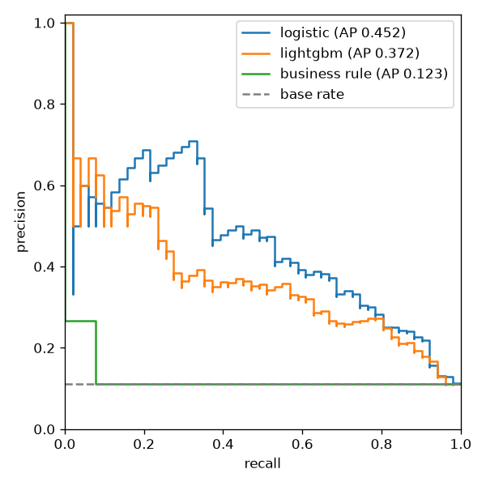
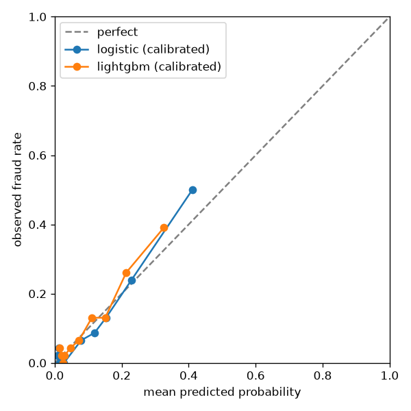
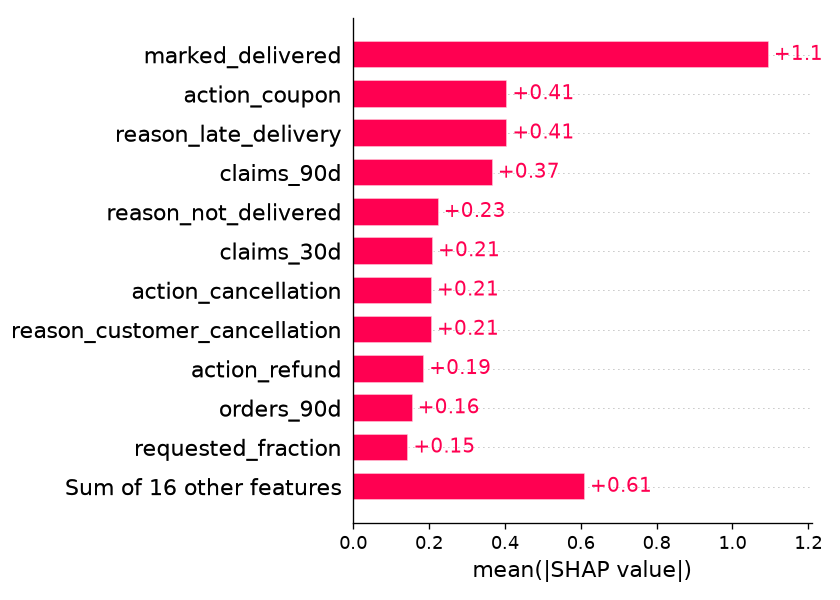

# Antifraude de reembolso: relatório

Change 10 (`antifraude-reembolso`). O desenho está em `ml-e-avaliacao.md`, seção 1.4; as decisões, em
`decisoes-arquitetura.md`. Os números abaixo saem de uma execução de `python -m research.fraud.train`
(semente 20261109, dataset `v1.0.0`), registrada no MLflow local.

## Resumo

- **Modelo escolhido: regressão logística calibrada (sigmoide)**, sobre 27 features calculadas no ponto do tempo.
  O LightGBM era o candidato e perdeu na regra de escolha, escrita antes de rodar.
- **No teste (outubro, 462 reclamações, 51 fraudes):** PR-AUC 0,452 [0,348; 0,596], ROC-AUC 0,839, Brier 0,0770.
- **Custo:** revisar quando `probabilidade × valor pedido ≥ R$ 4,00` custa **R$ 1,25 por reclamação**, contra
  R$ 3,14 da regra de negócio, R$ 3,22 de nunca revisar e R$ 1,65 do melhor limiar fixo.
- **A aplicação reproduz a pesquisa:** a probabilidade calculada pelo *scorer* da aplicação, a partir dos números
  publicados, difere da do scikit-learn em no máximo 2,2e-16 em todo o teste (a exigência era 1e-9).

## Dados e população

- Dataset sintético `v1.0.0` (Hugging Face, commit `cc5be0958e3e4971c284031ceb6406c43e96ae84`), conferido pelo
  SHA-256 de cada arquivo antes de qualquer feature.
- **População pontuada:** as reclamações que a política não negou, porque o nó `score_fraud` só roda depois da
  política. São 3.159 das 3.378; as 219 negadas saem do treino e do teste.
- Taxa de fraude da população: 10,9% (345 fraudes).
- O arquivo de verdade do gerador (perfil do cliente, incidente, rótulo trocado) nunca é lido; um teste confere.

## Divisão por tempo

| Conjunto | Meses de 2026 | Reclamações | Fraudes |
| --- | --- | --- | --- |
| Treino | maio a agosto | 2.156 | 237 |
| Validação | setembro | 541 | 57 |
| Teste | outubro | 462 | 51 |

Os hiperparâmetros do LightGBM saíram de três dobras de janela crescente dentro do treino (maio → junho, maio e
junho → julho, maio a julho → agosto), sem tocar setembro. Grade de 12 pontos; o melhor foi `num_leaves` 7,
`min_child_samples` 50, `learning_rate` 0,05 com 200 árvores e `reg_lambda` 1,0 (PR-AUC média nas dobras 0,278):
a borda mais regularizada da grade, sinal de que há pouca estrutura não linear para aprender com tão poucos casos.

## Escolha do modelo (só setembro)

A regra, escrita no design antes da primeira execução: o LightGBM só é escolhido se o intervalo de 95% da
diferença de PR-AUC para a logística (*bootstrap* pareado e estratificado, 2.000 reamostras) ficar todo acima de
zero. O escolhido precisa vencer a regra de negócio pelo mesmo critério.

| Validação (setembro) | PR-AUC [IC 95%] |
| --- | --- |
| Regressão logística | 0,396 [0,307; 0,535] |
| LightGBM | 0,301 [0,234; 0,426] |
| Regra "3 ou mais reclamações em 30 dias" | 0,147 [0,109; 0,218] |
| **LightGBM − logística** | **−0,096 [−0,182; −0,007]** |
| **Logística − regra** | **+0,249 [+0,149; +0,382]** |

O intervalo da diferença ficou todo **abaixo** de zero: a logística não só empatou, ela foi melhor. Pela regra, fica
o modelo mais simples. A grade não foi mexida depois de ver a validação: mudar a busca até o LightGBM ganhar seria
ajustar a pesquisa ao resultado.

**O que isso muda na aplicação:** o adaptador é um produto escalar em numpy (coeficientes e padronização em JSON),
sem `lightgbm` nem scikit-learn na imagem, sem thread e sem a exceção do `.predict(` no teste de arquitetura.

## Teste (outubro, calculado uma vez, depois da escolha)

| Modelo | PR-AUC [IC 95%] | ROC-AUC | Brier | Recall nos 5% mais suspeitos |
| --- | --- | --- | --- | --- |
| **Regressão logística (calibrada)** | **0,452 [0,348; 0,596]** | **0,839** | **0,0770** | **0,333** |
| LightGBM (calibrado) | 0,372 [0,272; 0,507] | 0,802 | 0,0841 | 0,235 |
| Regra de negócio | 0,123 [0,110; 0,167] | 0,526 | — | 0,078 |

- A taxa de fraude do teste é 11,0%: um modelo que só soubesse a taxa teria PR-AUC 0,110 e Brier 0,098.
- A regra de negócio quase não separa: poucos clientes chegam a 3 reclamações em 30 dias, e entre eles a fraude
  não é muito mais comum.
- Mandando para revisão só os 24 casos mais suspeitos (5%), a logística pega um terço das fraudes.



### Calibração

O calibrador sigmoide foi ajustado em setembro sobre a saída bruta da logística: `p = 1 / (1 + exp(a · bruta + b))`,
com `a = −1,1096` e `b = −0,0359`. Na curva de confiabilidade (10 faixas de mesmo tamanho), as faixas ficam perto da
diagonal; a mais alta prevê 0,41 e observa 0,50, com 46 casos. Com tão poucas fraudes, cada faixa tem de 0 a 23 delas,
e o desvio está dentro do esperado para esse tamanho.



## Custo esperado por regra (teste)

Premissa: uma revisão custa R$ 4,00 e pega a fraude; uma fraude não revisada custa o valor pedido; uma reclamação
honesta não revisada custa zero.

| Regra | Revisadas | Fraudes pegas | Custo total | Por reclamação |
| --- | --- | --- | --- | --- |
| Nunca revisar | 0 | 0 | R$ 1.485,48 | R$ 3,22 |
| Revisar tudo | 462 | 51 | R$ 1.848,00 | R$ 4,00 |
| Regra de negócio (3+ em 30 dias) | 15 | 4 | R$ 1.448,84 | R$ 3,14 |
| Limiar fixo do `TunedThresholdClassifierCV` (p ≥ 0,266) | 57 | 27 | R$ 761,59 | R$ 1,65 |
| **Regra por custo: p × valor ≥ R$ 4,00** | **93** | **31** | **R$ 578,05** | **R$ 1,25** |

A regra por custo revisa mais casos que o limiar fixo, mas escolhe melhor quais: uma nota média num pedido caro vai
para revisão, e a mesma nota num pedido barato não vai. Ela custa 61% menos que não ter antifraude. O limiar fixo
foi ajustado em setembro com um *scorer* de custo que recebe o valor de cada reclamação por *metadata routing*.

## O que pesa

SHAP global da biblioteca `shap` no teste (média do valor absoluto da contribuição, no espaço bruto):



- **`marked_delivered`** domina: o padrão "o app marcou entregue, mas o cliente diz que não chegou" é o golpe mais
  comum do gerador. O coeficiente é positivo (+1,43 por desvio-padrão).
- **Histórico de reclamações** (`claims_90d`, `claims_30d`, valor pedido em 30 dias) vem depois. Os coeficientes de
  `claims_30d` (−0,24) e `claims_90d` (+0,39) têm sinais opostos porque as duas contam quase a mesma coisa: só o
  efeito somado tem leitura. Por isso o relatório mostra contribuições, e não coeficientes isolados.
- **Tipo e motivo** (cupom por atraso pesa para baixo; reembolso por "não entregue" pesa para cima).
- `requested_fraction` (o exagero do oportunista) entra, mas com peso menor do que se esperava.

Na aplicação, a contribuição de cada feature é `coeficiente × valor padronizado`, e o resultado traz as três
maiores em valor absoluto, com sinal e sem o valor de nenhuma feature.

## A aplicação é igual à pesquisa

- **Features:** um só código (`fraud/features.py`). Um teste de paridade grava um histórico no Postgres (pedidos de
  aprovação, ações automáticas, uma reclamação negada que não é gravada) e o mesmo histórico no formato do dataset; os
  dois vetores são idênticos.
- **Modelo:** o `research.fraud.train` monta o modelo da aplicação a partir dos JSON exportados e pontua o teste pelo
  `LogisticFraudScorer`. A maior diferença para o `CalibratedClassifierCV` foi 2,2e-16.
- **Ponto no tempo:** um teste de propriedade acrescenta pedidos, reclamações e uma entrega no mesmo instante da
  reclamação e depois dela, e confere que o vetor não muda.

## Porta do CI

`python -m research.fraud.gate` baixa o dataset e o modelo nas revisões fixas (com cache), recalcula as features de
outubro com o código atual e pontua pelo *scorer* da aplicação. Falha quando:

- a PR-AUC fica abaixo de **0,4424** (medido 0,4524, menos 0,01);
- o Brier fica acima de **0,0820** (medido 0,0770, mais 0,005).

A pontuação é determinística, então a margem só cobre diferença de plataforma. Uma mudança de feature que estrague o
modelo servido quebra o CI.

## Limites

- **Dados sintéticos.** O modelo aprendeu o gerador, não a fraude real; o *model card* diz isso e lista os usos não
  pretendidos (decidir sobre pessoas reais).
- **Poucos positivos:** 57 fraudes na validação e 51 no teste. Os intervalos são largos; o do teste vai de 0,35 a
  0,60.
- **Aquecimento:** os pedidos começam em 01/05, então as janelas de 90 dias ficam incompletas de maio a julho. O
  treino vê históricos mais curtos que os de produção; validação e teste têm a janela inteira.
- **Calibração sigmoide**, não isotônica: são cerca de 60 positivos por mês, longe dos ~1.000 que a isotônica pede.
- **Instante da ação automática:** na aplicação, a reclamação automática conta pelo `executed_at`, segundos depois
  do `claimed_at`; só importa na borda das janelas.
- **A nota não é reavaliada** quando a aprovação é executada: a política é; a nota, não.

## Segurança (checklist de `seguranca.md`, seção 7)

- **Artefato:** só JSON com números; nenhum *pickle*. Revisão, tamanho e SHA-256 do manifesto fixados no código; cada
  arquivo conferido pelo SHA-256 listado no manifesto antes de ser lido; o modelo é recusado se o esquema de features
  for outro.
- **Dados pessoais:** nenhuma feature usa nome, CPF, telefone, e-mail, endereço, CEP, bairro, cidade ou o texto da
  mensagem (teste dos nomes proibidos). O evento `fraud.scored` leva versão, probabilidade, revisão indicada, tipo de
  ação, latência e ID do pedido, e nenhum valor de feature de histórico.
- **Sem texto de fora:** a proposta só entra pelo valor e pelos enums, já validados pela política. Não há prompt,
  rota nem ferramenta nova.
- **Segredos:** o `HF_TOKEN` só é lido na publicação; uma falha do Hub mostra só o tipo do erro.

## Como reproduzir

```bash
uv sync --group research
uv run python -m research.fraud.gate            # baixa o dataset v1.0.0 e o modelo nas revisões fixas, e confere
uv run python -m research.fraud.train           # treino, escolha, teste e MLflow (mlruns/)
uv run python -m research.fraud.publish         # ensaio: mostra arquivos, hashes e destino
uv run python -m deliverius.cli fraud fetch-model # o que a aplicação usa
```
