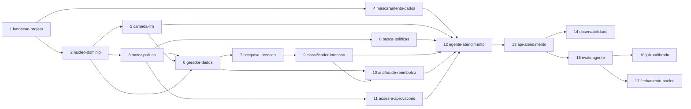

# Roadmap

Cada linha é uma **change do OpenSpec** (`/opsx:propose <nome>` → `/opsx:apply` → `/opsx:archive`). A data é a
meta para arquivar a change. Os IDs R01–R26 estão em `requisitos.md`. Este roadmap só diz **o que** entra em cada
change e **quando ela está pronta**; o **como** já está decidido nos outros documentos de `docs/` e não se redecide
na proposal.

- **Núcleo, de 1 a 20/11/2026:** o agente que age dentro da política, com aprovação humana, apoiado pelo
  classificador, pelo antifraude e pelo RAG, medido por evals, com os números no README.
- **Extras, de 21 a 30/11/2026, nesta ordem:** demo pública → LoRA → MCP → n8n. O front próprio fica para depois de
  novembro. Se o prazo apertar, corta-se do fim para o começo: n8n, depois MCP, depois LoRA.

## Visão geral

| # | Change | Fase | Meta (2026) | Depende de | Requisitos |
| --- | --- | --- | --- | --- | --- |
| 1 | `fundacao-projeto` | F0 Fundação | 1–2/11 | — | R01, R11, R18, R23 |
| 2 | `nucleo-dominio` | F1 Domínio e dados | 3–4/11 | 1 | R01 |
| 3 | `motor-politica` | F1 | 4–5/11 | 2 | R12, R22 |
| 4 | `mascaramento-dados` | F1 | 5–6/11 | 1 | R22 |
| 5 | `camada-llm` | F1 | 6–7/11 | 2 | R03, R13, R21 |
| 6 | `gerador-dados` | F1 | 7–9/11 | 2, 3, 5 | R05, R07 |
| 7 | `pesquisa-intencao` | F2 Modelos e busca | 9–12/11 | 6 e o teste escrito por pessoas | R04, R05, R06, R07, R08, R09, R24 |
| 8 | `busca-politicas` | F2 | 10–11/11 | 2, 3 | R08, R19 |
| 9 | `classificador-intencao` | F2 | 12/11 | 7 | R03 |
| 10 | `antifraude-reembolso` | F2 | 12–14/11 | 6, 9 | R03, R04, R05, R06, R07, R24 |
| 11 | `acoes-e-aprovacoes` | F3 Agente e API | 14/11 | 2, 3 | R12, R22 |
| 12 | `agente-atendimento` | F3 | 15–16/11 | 4, 5, 8, 9, 10, 11 | R12, R13, R14 |
| 13 | `api-atendimento` | F3 | 17/11 | 12 | R02, R22 |
| 14 | `observabilidade` | F3 | 18/11 | 13 | R21 |
| 15 | `evals-agente` | F4 Avaliação | 18–20/11 | 13 | R05, R13, R14, R15, R20, R22 |
| 16 | `juiz-calibrado` | F4 | 19–20/11 | 15 e os 60 rótulos humanos | R20 |
| 17 | `fechamento-nucleo` | F4 | 20/11 | 15 | R25 |
| E1 | `metricas-operacao` | F5 Demo | 21/11 | 13, 14 | R15, R16 |
| E2 | `sandbox-demo` | F5 | 22/11 | 13 | R17, R22 |
| E3 | `demo-gradio` | F5 | 23–24/11 | E1, E2 | R02, R16, R17 |
| E4 | `deploy-demo` | F5 | 25/11 | E3 | R17, R23 |
| E5 | `lora-intencao` | F6 Extras de ML e integração | 26–27/11 | 7 | R04, R07, R08 |
| E6 | `servidor-mcp` | F6 | 28/11 | 13 | R26 |
| E7 | `automacao-n8n` | F6 | 29/11 | 13, E1 | R15 |
| — | Trilha de publicação (sem change) | F6 | 28–30/11 | 7, 10, 17 | R09, R10, R25 |
| E8 | `front-proprio` | Depois de novembro | — | 13, E2 | R02 |

## Dependências

O caminho crítico é 1 → 2 → 3 → 6 → 7 → 9 → 10 → 12 → 13 → 15 → 17. A `busca-politicas` (8) e o
`mascaramento-dados` (4) ficam fora dele: são feitas nas esperas, como enquanto o BERTimbau treina no Kaggle.

## O que vale para toda change

Uma change só é arquivada quando:

1. o `design.md` respondeu ao checklist de `robustez.md`, seção 11 (autorização, corrida, idempotência,
   timeout, limite, falha no meio, entrada, compatibilidade, eventos de log), e cada corrida apontada tem um
   teste que dispara as operações juntas;
2. a verificação do `CLAUDE.md` passa (`ruff format --check`, `ruff check`, `mypy`, `pytest`), mais o
   `pytest -m integration` se a change toca no banco, e o `lint-imports` a partir da change 1;
3. a cobertura atinge a meta de `convencoes-codigo.md`: 100% dos ramos em `policy`, `privacy`, `actions` e
   `fraud/features`, 85% no total;
4. toda decisão nova está em `decisoes-arquitetura.md`, com as alternativas;
5. variável nova está no `.env.example`, e nenhum segredo entrou no repositório;
6. se a change produz evidência pública (número, link, relatório), o README foi atualizado;
7. o checklist de `seguranca.md`, seção 7, foi conferido;
8. as specs foram sincronizadas em `openspec/specs/` pelo `/opsx:archive`.

## Núcleo (1 a 20/11)

### F0. Fundação

#### 1. `fundacao-projeto` (1–2/11)

**Arquivada em 2026-10-31** (`openspec/changes/archive/2026-10-31-fundacao-projeto/`). Além do previsto, o
`/health` ganhou tempo limite e trata falha do banco no meio da verificação como 503.

- **Escopo:** uv, ruff, mypy estrito, pytest com os marcadores `integration` e `llm`, `docker-compose.yml`
  (pgvector na porta 5433), `Settings`, engine assíncrona, Alembic com a extensão `vector`, `GET /health`,
  `ci.yml`, um Dockerfile multiestágio ainda sem modelos e o README inicial.
- **Fora:** tabelas do domínio, `/ready` (entra com os modelos, na change 9) e modelos embutidos na imagem (change E4).
- **Spec:** `health-check`.
- **Pronto quando:** o CI passa num PR; `/health` responde 200 com o banco no ar e 503 com o banco parado; a imagem
  Docker sobe e responde ao `/health`; um import proibido, de propósito, quebra o `lint-imports`.

### F1. Domínio e dados

#### 2. `nucleo-dominio` (3–4/11)

- **Escopo:**
  - `shared/`: `Money` em centavos inteiros, IDs UUID v7, `Clock` injetável e erros base (`DeliveriusError`, que
    passa a ser a base do `DatabaseUnavailableError` criado na change 1);
  - `orders/`: cliente, restaurante, pedido, item, entrega e eventos da entrega, com o repositório;
  - tabelas e migrations de `modelo-dominio.md`, seção 2, inclusive o `audit_log` com o trigger que recusa UPDATE e
    DELETE, as restrições que são a última barreira (`CHECK` de valores, chaves estrangeiras) e os índices de
    `sandbox_id` e `customer_id`;
  - `AccessScope` obrigatório em todo método de repositório que toca dado de cliente (`autorizacao.md`, seção 4);
  - pool de conexões e `statement_timeout` (`robustez.md`, seção 3);
  - structlog configurado, com eventos `<módulo>.<evento>` e o filtro de mascaramento plugável (`robustez.md`,
    seção 5).
- **Fora:** as tabelas de ações e aprovações (change 11) e de conversas e `llm_calls` (changes 5 e 13).
- **Specs:** `pedidos` e `auditoria`.
- **Pronto quando:** `Money` tem testes de propriedade (Hypothesis); os repositórios passam nos testes de
  integração; o teste prova que um UPDATE no `audit_log` falha; um teste prova que o repositório não devolve o
  pedido de outro cliente nem de outra sandbox; uma consulta acima do `statement_timeout` é interrompida.

#### 3. `motor-politica` (4–5/11)

**Arquivada em 2026-11-01** (`openspec/changes/archive/2026-11-01-motor-politica/`). Além do previsto, o atraso
passou a ser compensado uma vez por pedido (`delay_already_compensated`), e o preenchimento dos marcadores saiu
da change 8 para esta.

- **Escopo:**
  - `policy/limits.py` como fonte única dos números;
  - os documentos `POL-xx` em markdown, com os marcadores dos números;
  - o preenchimento dos marcadores (`render_policy_document`), que recusa marcador desconhecido;
  - o motor `evaluate`, que devolve `PolicyDecision` (permitida, precisa de aprovação ou negada, com motivo e teto)
    para reembolso, cupom e cancelamento.
- **Fora:** a indexação dos documentos para o RAG (change 8).
- **Spec:** `politica`.
- **Pronto quando:** 100% de cobertura de ramos; cada regra de `modelo-dominio.md`, seção 3, tem pelo menos um teste;
  o motor é Python puro, e o `lint-imports` garante isso; todo marcador dos documentos existe em `limits.py`, e
  nenhum documento escreve um valor ou um prazo à mão.

#### 4. `mascaramento-dados` (5–6/11)

**Arquivada em 2026-11-02** (`openspec/changes/archive/2026-11-02-mascaramento-dados/`, com o `relatorio.md`).
Além do previsto, reconhece o CNPJ alfanumérico e corrigiu o texto de exceções, que chegava ao log sem filtro.

- **Escopo:** módulo `privacy/` próprio, com:
  - CPF e CNPJ (também alfanumérico) com dígito verificador, cartão com Luhn, telefone, e-mail, CEP e endereço;
  - normalização NFKC, remoção de caracteres invisíveis e conversão de dígitos e hífens antes de mascarar
    (`robustez.md`, seção 6);
  - marcadores tipados e estáveis na conversa (`[CPF_1]`), com registro por HMAC, sem guardar o valor;
  - o filtro de mascaramento para o logger, e a correção do texto de exceções, que chegava ao log sem filtro.
- **Fora:** o filtro no exportador de traces (change 14).
- **Spec:** `mascaramento`.
- **Pronto quando:** 100% de cobertura de ramos; o recall por tipo de dado, medido num conjunto com dados do Faker
  pt-BR, está no relatório da change; o limite com nomes próprios está escrito, com o número medido; CPF com dígitos de largura total ou caracteres
  invisíveis também é mascarado; nenhuma regex passa de 50 ms numa entrada de 1.000 caracteres feita para travar;
  o exemplo oficial de CNPJ alfanumérico é reconhecido; um CPF numa exceção não chega ao log, em nenhum formato; UUID
  e carimbo de tempo atravessam o filtro intactos.

#### 5. `camada-llm` (6–7/11)

- **Escopo:** `llm/` como em `arquitetura.md`, seção "Camada de LLM":
  - papéis, fábrica (Gemini, compatível com OpenAI, Anthropic), preços e prompts versionados;
  - registro de uso na tabela `llm_calls`, com o custo real e o equivalente;
  - orçamento diário com **reserva atômica** antes da chamada e modo degradado;
  - limite de requisições por provedor, e uma **pausa do provedor** (`ProviderGate`) depois de um `429`, pelo
    `Retry-After` ou `retryDelay`;
  - novas tentativas numa camada só (`with_retry`, com as dos SDKs desligadas), reserva de modelo
    (`with_fallbacks`) e `call_or_degrade`, que devolve a resposta ou o modo degradado como resultado tipado;
  - cache próprio (`SqliteResponseCache`) só para evals e geração de dados, com o número da tentativa na chave;
  - modelo falso roteirizado para os testes;
  - a regra de que nenhum código de `src/` chama um modelo de forma síncrona (`invoke` e afins), conferida por
    teste de arquitetura.
- **Fora:** prompts do agente (change 12) e spans do OpenTelemetry (change 14).
- **Spec:** `llm`.
- **Pronto quando:** a fábrica tem teste para os três provedores; um teste `-m llm` faz uma chamada real ao Gemini e
  outra ao Groq e registra tokens e custo; o orçamento estourado leva ao modo degradado, num teste com o falso;
  chamadas disparadas juntas nunca passam do orçamento (teste de integração com `asyncio.gather`: 50 chamadas com
  10 restantes dão exatamente 10 reservas); um `429` com `Retry-After: 60` leva à reserva, e nenhuma requisição sai
  para o principal até o relógio andar 60 s; nenhum texto de mensagem ou de erro do provedor aparece em `llm_calls`
  nem nos logs. Fica por conferir, com as chaves, a temperatura do Gemini 3.x (a biblioteca avisa que ele ignora
  esse parâmetro) e o local do `retryDelay`.

#### 6. `gerador-dados` (7–9/11)

- **Escopo:** `datagen/` e a CLI, nas cinco camadas de `modelo-dominio.md`, seção 4:
  - simulador do mundo com semente;
  - reclamações e rótulos de fraude;
  - resolução correta pelo motor de política;
  - mensagens escritas pelo LLM (papel `datagen`);
  - cenários de ponta a ponta com o estado final esperado.

  Também entram o teste sintético escrito por outro gerador (Groq) e a publicação dos conjuntos no Hugging Face
  Datasets, com versão e *dataset card*.

  Detalhado na proposta: mensagens em treino, validação e teste (70/15/15 por cenário); ≈ 60 pares pergunta → seção
  da política; formato e validação do teste escrito por pessoas; manifesto com hashes e commit; papel
  `datagen_holdout` e `call_structured` na camada de LLM; checagem do orçamento no próprio gerador (com cache, o
  governor conta e não barra).
- **Fora:** o teste escrito por pessoas, que é tarefa humana (ver "Tarefas fora do código").
- **Spec:** `dados-sinteticos`.
- **Pronto quando:** a mesma versão e a mesma semente geram os mesmos dados (teste); existem os conjuntos e
  tamanhos de `modelo-dominio.md`, seção 4; a divisão por cenário e a divisão por tempo têm teste contra
  vazamento; o dataset está no Hugging Face com card.

**Marco M1 (9/11): dados prontos.**

### F2. Modelos e busca

#### 7. `pesquisa-intencao` (9–12/11)

- **Escopo:** `research/intent/` com as quatro abordagens do núcleo de `ml-e-avaliacao.md`, seção 1.3:
  1. TF-IDF + regressão logística;
  2. e5-small + regressão logística;
  3. BERTimbau com ajuste fino no Kaggle, exportado para ONNX int8;
  4. LLM sem treino.

  Todas são avaliadas pelo mesmo script, local, em CPU, nos três conjuntos de teste, e registradas no MLflow. O
  vencedor é publicado no Hugging Face com model card e `manifest.json`. O relatório fica em
  `docs/pesquisa-intencao.md`, e o notebook de treino fica público no Kaggle.
- **Fora:** LoRA (extra E5) e o uso do modelo pela aplicação (change 9).
- **Spec:** nenhuma. É pesquisa, com proposal, design e tasks.
- **Pronto quando:** a tabela compara F1 macro com intervalo de 95%, recall de `sensitive`, ECE, p50/p95 e custo nos
  três conjuntos; a escolha segue a regra escrita **antes** dos experimentos; o modelo está no Hugging Face numa
  revisão fixa.

#### 8. `busca-politicas` (10–11/11)

- **Escopo:** `retrieval/`:
  - e5-small exportado para ONNX;
  - indexação por seção, com os números preenchidos com `render_policy_document` (change 3), pela CLI, com o hash
    do documento;
  - configuração `pt_unaccent`;
  - busca híbrida com RRF em SQL;
  - regra de "busca não confiável".

  Mais a mini-pesquisa com os cerca de 60 pares pergunta → trecho.
- **Fora:** a variante com embedding maior, se não sobrar tempo.
- **Spec:** `busca-politicas`.
- **Pronto quando:** a tabela compara lexical, semântica e híbrida em recall@3 e MRR; recall@3 e MRR entram como
  porta no CI; a busca roda sem torch.

#### 9. `classificador-intencao` (12/11)

- **Escopo:**
  - `intent/`: porta `IntentClassifier`, adaptador ONNX com temperatura e a rede de segurança por palavras-chave
    para o caminho sensível;
  - a carga de artefatos do Hugging Face com revisão fixa e conferência do `manifest.json`, reaproveitada pelo
    antifraude;
  - `GET /ready`.
- **Spec:** `classificacao-intencao`.
- **Pronto quando:** a aplicação classifica sem torch; o `/ready` falha se o esquema não bater; o F1 e o recall de
  `sensitive` viram porta no CI para PRs que mexem em `intent`; as palavras-chave levam ao caminho sensível mesmo
  com o classificador falso errando.

#### 10. `antifraude-reembolso` (12–14/11)

- **Escopo:**
  - `fraud/features.py`, um só código para o treino e para a aplicação, calculado no ponto do tempo;
  - `research/fraud/`: split por tempo, LightGBM, calibração, regra de revisão por custo comparada com o
    `TunedThresholdClassifierCV` e SHAP;
  - o adaptador `FraudScorer` com `pred_contrib`;
  - a publicação no Hugging Face com model card e manifesto;
  - o teste de arquitetura da change 5 proíbe `.predict(` em `src/` (ele existe para o `invoke` síncrono de
    modelos de chat). O `FraudScorer` vai precisar de uma lista de módulos permitidos ou de a regra ser restrita
    aos modelos de chat, decidido nesta change.

  O treino é local, em CPU, então a pesquisa e o serviço cabem numa change só.
- **Fora:** o dataset e o notebook no Kaggle (trilha de publicação).
- **Spec:** `antifraude`.
- **Pronto quando:** PR-AUC, Brier, curva de confiabilidade e custo esperado no teste, contra um baseline de regras;
  100% de cobertura de ramos em `fraud/features`; um teste prova que nenhuma feature usa dado posterior à
  reclamação; PR-AUC e Brier viram porta no CI.

**Marco M2 (14/11): modelos servidos pela aplicação.**

### F3. Agente e API

#### 11. `acoes-e-aprovacoes` (14/11)

- **Escopo:**
  - `actions/`: reembolso, cupom e cancelamento com chave de idempotência e auditoria na mesma transação, com o
    pedido travado (`FOR UPDATE`) e a **política reavaliada na hora da execução**;
  - `approvals/`: criar, listar e decidir (com trava otimista e motivo obrigatório; a mesma decisão repetida é
    idempotente), uma aprovação pendente por conversa (índice único parcial), mais a transferência com resumo
    estruturado.
- **Spec:** `acoes` e `aprovacoes`.
- **Pronto quando:** 100% de cobertura de ramos em `actions`; testes de integração com operações disparadas juntas
  provam: a mesma ação gera um único reembolso; dois reembolsos diferentes no mesmo pedido nunca passam do teto;
  dois revisores decidindo ao mesmo tempo geram uma decisão; decidir sem motivo ou numa versão velha falha.

#### 12. `agente-atendimento` (15–16/11)

- **Escopo:** `agent/`, com o grafo de `arquitetura.md`, seção "Desenho do agente":
  - nós, roteamento e as quatro ferramentas de leitura com o escopo vindo do contexto;
  - `ActionProposal`, `interrupt` com `AsyncPostgresSaver`, limites (inclusive o prazo total do turno),
    `compose_reply` e `validate_reply`, que usa `privacy.find_personal_data` na saída do LLM;
  - `mask_input` com `privacy.mask_text` e o `MarkerLedger` no estado; a variável de ambiente da chave, com pelo menos
    32 bytes e falha na subida se faltar; a rede de palavras-chave lê o texto de `privacy.normalize_text`;
  - os prompts `v1`;
  - `bootstrap.py`, que chama `LlmRuntime.build` na subida (com os papéis em uso) e entrega os dois modelos de
    `RoleModels` ao `ModelFallbackMiddleware` do agente; os outros papéis usam `runnable()` e `call_or_degrade`.
    O `ModelRetryMiddleware` do agente também chama o modelo de novo e deve passar pelo governor, o que esta
    change confere.
- **Fora:** a API (change 13) e qualquer ferramenta que escreve, que não existe por desenho.
- **Spec:** `agente`.
- **Pronto quando:** os sete cenários de `fluxos-do-agente.md` passam no pytest com o LLM falso e sem rede; retomar
  duas vezes a mesma aprovação gera um só reembolso; o caminho sensível não chama nenhum LLM; com o LLM falso travando, o turno estoura o prazo e cai no modo degradado
  sem ação; o LLM falso pedindo o pedido de outro cliente recebe o pedido do contexto; uma conversa real de
  ponta a ponta funciona com o Gemini e com o Groq (`-m llm`).

#### 13. `api-atendimento` (17/11)

- **Escopo:** `api/`:
  - conversas com SSE;
  - resposta "em análise" quando há aprovação pendente;
  - rotas de aprovação e de transferência para o papel `reviewer`;
  - JWT curto com papel, validado como em `autorizacao.md`, seção 5; rotas protegidas por padrão e papel por
    rota; respostas com modelo próprio por papel e entradas com `extra="forbid"`; objeto de outro → `404`;
    registro de qual revisor abriu qual conversa;
  - **uma vez por conversa:** lease com UPDATE condicional (`409 turn_in_progress`), também na retomada;
  - `client_message_id` para a mensagem reenviada não rodar o grafo de novo;
  - o turno roda numa tarefa da aplicação, independente da conexão SSE, e o resultado fica em
    `GET /v1/conversations/{id}`;
  - limites de `robustez.md`, seção 3: requisições (`429` com `Retry-After`), turnos simultâneos e conexões SSE
    (`503 busy`), tamanho da mensagem, paginação por cursor;
  - rotas em `/v1`; desligamento que espera os turnos em andamento;
  - erros como *problem details*;
  - a tarefa de retenção e anonimização de `seguranca.md`, seção 3.5, com `pg_try_advisory_lock` e lotes, que
    inclui a retenção das linhas antigas de `llm_budget_usage`;
  - a chave estrangeira de `llm_calls.conversation_id` para `conversations`, criada `NOT VALID` e validada depois,
    para não travar a tabela.
- **Fora:** a sandbox por visitante (extra E2) e as rotas de direitos do titular.
- **Spec:** `api-conversas`.
- **Pronto quando:** o cenário F2 (reembolso alto) roda inteiro pela API: pausa, o revisor aprova, a conversa retoma
  e o reembolso é executado; **o teste da matriz de autorização** cobre toda rota com os seis atores de
  `autorizacao.md`, seção 6, e falha se houver rota fora da matriz; nenhum campo proibido ao cliente aparece nas
  respostas dele; duas mensagens disparadas juntas na mesma conversa geram um turno e um `409`; a mesma mensagem
  reenviada não roda o grafo de novo; fechar a conexão no meio do turno não impede a ação nem a resposta; um
  checkpoint pausado é retomado depois de reiniciar a aplicação; o `/docs` descreve todas as rotas.

**Marco M3 (17/11): conversa de ponta a ponta pela API.**

#### 14. `observabilidade` (18/11)

- **Escopo:**
  - um `TracerProvider` com instrumentação de FastAPI, httpx e banco;
  - o Langfuse v4 com o `CallbackHandler`, trace por turno e sessão por conversa;
  - o `trace_id` em todo log do structlog (configurado na change 2), no cabeçalho `X-Trace-Id` e nas tabelas;
  - exportação em lote e assíncrona: o Langfuse fora do ar não atrasa a conversa;
  - mascaramento no exportador, com `privacy.redact_text` (change 4).
- **Fora:** as visões do painel (extra E1).
- **Spec:** `observabilidade`.
- **Pronto quando:** um turno aparece no Langfuse com nós, ferramentas, tokens e custo; da linha do `audit_log`
  chega-se ao trace; um teste prova que um CPF não chega ao exportador.

### F4. Avaliação e fechamento

#### 15. `evals-agente` (18–20/11)

- **Escopo:** `evals/`, como em `ml-e-avaliacao.md`, parte 2:
  - cliente simulado de outra família de modelo;
  - sucesso pelo estado final do banco;
  - pass^1 e pass^3 com intervalo de Wilson;
  - suíte núcleo (30 × 3) e suíte de segurança (cerca de 40 ataques);
  - comparação de provedores (Groq e 10 cenários com o Ollama);
  - relatório em `docs/resultados/`;
  - `evals.yml` por `workflow_dispatch`.

  A suíte núcleo gasta de um a dois dias de cota, então a primeira execução começa no dia 18.
- **Fora:** a suíte completa de 150 cenários, que roda ao longo dos extras para os números finais.
- **Spec:** `evals`.
- **Pronto quando:** existe o relatório da suíte núcleo por provedor; violações de política = 0; ataques que viraram
  ação = 0; recall do caminho sensível = 100%; o relatório lista os cinco piores diálogos com o link do trace.

#### 16. `juiz-calibrado` (19–20/11)

- **Escopo:** juiz de clareza, empatia, tom e explicação; calibração com kappa ponderado contra os 60 rótulos
  humanos, para dois candidatos de família diferente da do agente; o juiz só entra no relatório se o kappa for
  maior ou igual a 0,6.
- **Spec:** entra na `evals`.
- **Pronto quando:** o relatório mostra o kappa dos candidatos e a decisão de usar ou não o juiz.

#### 17. `fechamento-nucleo` (20/11)

- **Escopo:**
  - o README de `entrega.md`, seção 7, menos o link da demo e o GIF: os números, o diagrama, as três decisões
    centrais, os links, como rodar e os limites honestos;
  - CHANGELOG e a tag `v0.1.0`.
- **Spec:** nenhuma.
- **Pronto quando:** todos os números do README apontam para um relatório em `docs/resultados/`; uma pessoa
  consegue rodar o projeto do zero com os comandos do README.

**Marco M4 (20/11): núcleo fechado.**

### Se o núcleo atrasar

Em cada marco, se a change prevista não estiver arquivada, corta-se nesta ordem, até voltar ao prazo:

1. `juiz-calibrado` vira extra: os números do README são objetivos e não dependem dele;
2. a comparação com o Ollama sai, e fica a do Groq;
3. a `observabilidade` fica só com o `trace_id` nos logs e nas tabelas, e o Langfuse vai para os extras;
4. a abordagem 2 (e5 + regressão logística) sai da pesquisa de intenção;
5. a suíte núcleo cai de 30 × 3 para 20 × 3.

**Não se corta:** o motor de política, a idempotência e a aprovação, o mascaramento, o caminho sensível sem LLM,
os evals de segurança e o teste escrito por pessoas. São o que dá sentido aos números.

## Extras (21 a 30/11)

### F5. Demo pública

#### E1. `metricas-operacao` (21/11)

- **Escopo:** as visões SQL de `observabilidade.md`, seção 4 (automação, custo, latência, intenções, aprovação e
  fraude), mais os eventos de robustez (conflitos de turno, `429`, `503`, negativas na reavaliação, modo
  degradado), expostas pela API só para o revisor; os alertas visíveis da seção 5.
- **Pronto quando:** cada métrica tem teste de integração com dados conhecidos e uma rota que a devolve.

#### E2. `sandbox-demo` (22/11)

- **Escopo:** `POST /sandbox` de `entrega.md`, seção 5: dados semeados, dois tokens, filtro obrigatório por
  `sandbox_id` em todo repositório, limpeza a cada hora (com advisory lock, sem apagar sandbox com lease ativa),
  teto global com reserva atômica e aviso honesto ao atingir o limite.
  A auditoria da sandbox expirada sai só pela função `purge_expired_sandbox_audit` (`SECURITY DEFINER`, papel de
  manutenção), única via que o trigger do `audit_log` aceita; o papel da aplicação perde `UPDATE` e `DELETE` sobre
  `audit_log` (decidido no design da change 2).
- **Pronto quando:** um teste prova que uma sandbox não vê os dados de outra; as sandboxes com mais de 24 h somem.

#### E3. `demo-gradio` (23–24/11)

- **Escopo:** Gradio montado no FastAPI, como cliente da própria API, com as abas Cliente, Atendente, Painel, Por
  dentro e Laboratório.
- **Pronto quando:** os cenários F1 a F5 de `fluxos-do-agente.md` rodam pela interface, inclusive a aprovação.

#### E4. `deploy-demo` (25/11)

- **Escopo:** imagem com os modelos embutidos pelas revisões fixas; Trivy; Neon; Hugging Face Spaces; deploy por
  tag com teste de fumaça; o link e o GIF no README.
- **Pronto quando:** a tag `v0.2.0` publica a demo, o teste de fumaça passa e o link funciona numa aba anônima.

### F6. Extras de ML e integração

#### E5. `lora-intencao` (26–27/11)

- **Escopo:** LoRA no Qwen3-0.6B (ou sucessor) no Kaggle, gerando intenção e entidades; a quinta linha na tabela
  da pesquisa; o adaptador publicado no Hugging Face.
- **Pronto quando:** a quinta abordagem está na tabela, medida pelo mesmo script e nos mesmos conjuntos.

#### E6. `servidor-mcp` (28/11)

- **Escopo:** as quatro ferramentas de leitura por *streamable HTTP*, no mesmo processo, com autenticação.
- **Pronto quando:** um cliente MCP (o Claude Code, por exemplo) lista e chama as ferramentas com um token válido, e
  é recusado sem ele.

#### E7. `automacao-n8n` (29/11)

- **Escopo:** um fluxo que recebe o *webhook* de transferência de prioridade alta e avisa por e-mail; um relatório
  diário com as métricas do painel. O evento sai por *outbox*, com novas tentativas e `event_id` para o n8n
  descartar duplicatas; qualquer chamada do n8n à API é assinada com HMAC. O fluxo exportado fica em
  `automations/`.
- **Pronto quando:** a transferência de um caso sensível dispara o aviso; o relatório chega uma vez por dia.

### Trilha de publicação (28–30/11, sem change)

É conteúdo, não código, e não entra na ordem de corte dos extras:

- o dataset e o notebook do antifraude no Kaggle;
- os cards dos modelos e datasets revistos com os números finais;
- o artigo técnico sobre o desenho do agente e os resultados;
- os links no README.

### Depois de novembro

#### E8. `front-proprio`

Front em React ou Next com design system, consumindo a mesma API. Telas já pensadas:

- **App do cliente:** pedidos; detalhe do pedido; chat com o Deli, com o cartão de ação, a citação no trecho da
  política e a transferência com resumo.
- **Console do atendente:** fila com as abas Aprovações e Transferências; detalhe com a nota antifraude e os fatores
  que mais pesaram; auditoria.
- **Painel de operação:** automação, custo, p50/p95, intenções, escalonamentos, fraude barrada e comparação entre
  provedores.
- **Avaliações e laboratório:** os relatórios dos evals e as comparações de modelos.

## Tarefas fora do código

| Tarefa | Prazo | Bloqueia |
| --- | --- | --- |
| Conferir o modelo Flash-Lite e a cota no AI Studio | 6/11 | `camada-llm` |
| Criar a chave do Groq e ativar a retenção zero | 6/11 | `camada-llm`, `gerador-dados` |
| Escrever as cerca de 150 mensagens do teste humano (com ajuda de outras pessoas) | 10/11 | `pesquisa-intencao` |
| Rotular 60 respostas do agente para calibrar o juiz | 19/11 | `juiz-calibrado` |
| Confirmar que dá para criar um Space Docker gratuito | 20/11 | `deploy-demo` |

## Requisitos ao fim do núcleo

Com o núcleo fechado em 20/11, 22 dos 26 requisitos têm evidência pública: 20 completos e 2 parciais. Os outros
4 ficam para os extras:

| Requisito | Entra em |
| --- | --- |
| R16 Painel | `metricas-operacao`, `demo-gradio` |
| R17 Demo pública | `deploy-demo` |
| R26 MCP | `servidor-mcp` |
| R10 Artigo | Trilha de publicação |
| R09 Notebook público | Parcial no núcleo (o notebook de treino no Kaggle); completo na trilha de publicação |
| R15 Automação | Parcial no núcleo (a taxa de automação nos relatórios); completo em `automacao-n8n` |

## Como este roadmap muda

- Change nova, cortada ou com a data mudada entra aqui, com a decisão registrada em `decisoes-arquitetura.md`.
- Ao arquivar uma change, a coluna de status do README avança.
- A proposal de cada change cita o número e o nome usados aqui.
